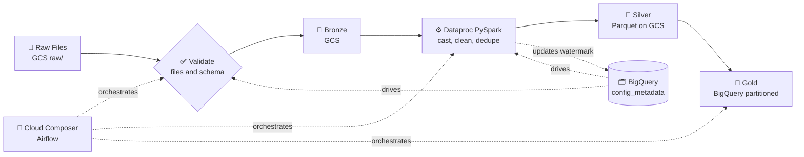

# 🚀 Metadata-Driven Data Pipeline on GCP


> A **config-driven, multi-provider ingestion framework** that implements a **Bronze → Silver → Gold** lakehouse on Google Cloud. Onboard a new data provider by inserting rows into BigQuery config tables. **No code changes needed.**

---

## 📌 Table of Contents
- [Overview](#-overview)
- [Architecture](#-architecture)
- [Tech Stack](#-tech-stack)
- [Repository Structure](#-repository-structure)
- [Metadata Layer](#-metadata-layer)
- [Pipeline Walkthrough](#-pipeline-walkthrough)
- [Key Design Highlights](#-key-design-highlights)
- [Dataset](#-dataset)
- [How to Run](#-how-to-run)
- [Roadmap](#-roadmap)
- [Author](#-author)

---

## 🎯 Overview

Hard-coding every data source into its own pipeline doesn't scale. This project takes the opposite approach: **pipeline behaviour is described as data**, not code.

Four BigQuery metadata tables control everything: file locations, schema casting, validation rules and incremental-load state. A single generic Airflow DAG and a single generic PySpark job read those tables at runtime and process every active provider.

**Result:** adding a provider = adding a few rows of config.

---

## 🏗️ Architecture



| Layer | Storage | Purpose |
|-------|---------|---------|
| 🗂️ **Raw** | GCS | Files exactly as the provider delivered them |
| 🥉 **Bronze** | GCS | Validated, archived copy of the source data |
| 🥈 **Silver** | GCS (Parquet) | Typed, cleansed, deduplicated records |
| 🥇 **Gold** | BigQuery | Partitioned, analytics-ready aggregates |

---

## 🧰 Tech Stack

| Category | Tools |
|----------|-------|
| ☁️ Cloud | Google Cloud Platform |
| 🎼 Orchestration | Cloud Composer (Apache Airflow) |
| ⚡ Processing | Dataproc (PySpark), Dataflow (Apache Beam) |
| 🗄️ Storage | Google Cloud Storage, BigQuery |
| 🐍 Language | Python, SQL |
| 📦 Formats | CSV (source), Parquet (Silver) |

---

## 📂 Repository Structure

```
GCP_Data_Engineering_Project/
├── BigQueryScript.sql        # DDL + seed data for the 4 metadata tables
├── fullairflowpandas.py      # Airflow DAG: validate → bronze → Dataproc → gold
├── bronze_to_silver.py       # Generic PySpark job (Bronze → Silver)
├── ingestbeam.py             # Apache Beam / Dataflow variant of the Silver layer
├── silver_retail_sales.csv   # Sample dataset
└── README.md
```

---

## 🗂️ Metadata Layer

All control tables live in the `config_metadata` BigQuery dataset.

| Table | What it controls |
|-------|------------------|
| 🔧 **DataConfig** | Raw/bronze/silver paths, file type, delimiter, header flag, write mode, ingestion frequency, active flag |
| 📐 **SchemaConfig** | Column names, data types and nullability per provider and table |
| 🧹 **ExtraConfig** | Validation and transformation rules, e.g. drop null customers, filter negative quantities, exclude cancelled invoices |
| ⏱️ **IngestionState** | Last processed time, max event time seen, lookback window, last run status |

**Example rules (retail provider):**
- `CustomerID IS NOT NULL`
- `Quantity > 0`
- `InvoiceNo NOT LIKE 'C%'`

---

## 🔄 Pipeline Walkthrough

1. **🔍 Discover providers**: the DAG reads active providers from `DataConfig`.
2. **✅ Validate**: checks that files exist, are non-empty, and contain every column expected in `SchemaConfig`.
3. **📦 Land in Bronze**: files move from `raw/` to `bronze/` in GCS.
4. **⚙️ Transform (Dataproc / PySpark)**:
   - Reads the provider's config at runtime
   - Casts columns to the configured data types
   - Applies incremental filtering with a **lookback window** for late-arriving data
   - Applies the configured validation/transformation rules
   - Deduplicates with a window function (`row_number()` over the latest `InvoiceDate`)
   - Writes Parquet to Silver
5. **🥇 Build Gold**: BigQuery aggregates sales by date and country into a **date-partitioned** table.
6. **📍 Update state**: the watermark in `IngestionState` is updated for the next run.

---

## ✨ Key Design Highlights

- 🧩 **Metadata-driven**: new providers are onboarded through config rows, not code.
- ♻️ **Incremental processing** with a watermark and a configurable **late-arrival lookback**.
- 🛡️ **Data quality built in**: file, schema and rule-based validation before data moves on.
- 🧹 **Idempotent-friendly dedup**: window-function deduplication keeps the latest record per key.
- 📊 **Partitioned Gold tables** for cost-efficient BigQuery queries.
- 🔀 **Two processing engines**: Spark on Dataproc and a Beam/Dataflow variant of the same Silver logic.
- 🔁 **Retries and per-provider task groups** in Airflow for isolated, resilient runs.

---

## 📊 Dataset

[UCI Online Retail dataset](https://archive.ics.uci.edu/dataset/352/online+retail): transactions from a UK-based online retailer.

| Column | Type | Description |
|--------|------|-------------|
| InvoiceNo | STRING | Invoice number (prefix `C` = cancellation) |
| StockCode | STRING | Product code |
| Description | STRING | Product description |
| Quantity | INT64 | Units sold |
| InvoiceDate | TIMESTAMP | Invoice date and time |
| UnitPrice | FLOAT64 | Price per unit |
| CustomerID | STRING | Customer identifier |
| Country | STRING | Customer country |

---

## ▶️ How to Run

**Prerequisites:** a GCP project with billing enabled, plus these APIs: BigQuery, Cloud Storage, Dataproc, Cloud Composer, Dataflow.

```bash
# 1. Clone
git clone https://github.com/SaTa05/GCP_Data_Engineering_Project.git
cd GCP_Data_Engineering_Project

# 2. Create the GCS bucket and folders
gsutil mb gs://retail-datalake
# raw/, bronze/, silver/ prefixes under provider-ingress/

# 3. Create the metadata tables in BigQuery
#    Run BigQueryScript.sql in the BigQuery console

# 4. Upload the Spark job
gsutil cp bronze_to_silver.py gs://retail-code/jobs/

# 5. Deploy the DAG to your Composer environment
gsutil cp fullairflowpandas.py gs://<composer-bucket>/dags/

# 6. Drop a source file into the raw path and trigger the DAG
gsutil cp silver_retail_sales.csv gs://retail-datalake/provider-ingress/raw/provider_retail/
```

> ⚠️ Replace placeholders (`your-gcp-project`, bucket names, region) with your own values.

---

## 🛣️ Roadmap

- [ ] Add an architecture screenshot and a successful Composer run screenshot
- [ ] Replace `eval()`-style rule evaluation with a safe expression parser in the Beam variant
- [ ] Parameterize the Gold build so providers don't overwrite each other
- [ ] Add data-quality metrics and alerting (row counts, rejected records)
- [ ] Add unit tests for config parsing and transformations
- [ ] Add CI with GitHub Actions
- [ ] Infrastructure as Code with Terraform

---

## 👩‍💻 Author

**Satarupa**
Data Engineer · PySpark · Airflow · Cloud Data Platforms

[](https://github.com/SaTa05)

⭐ If you found this useful, consider starring the repo!
